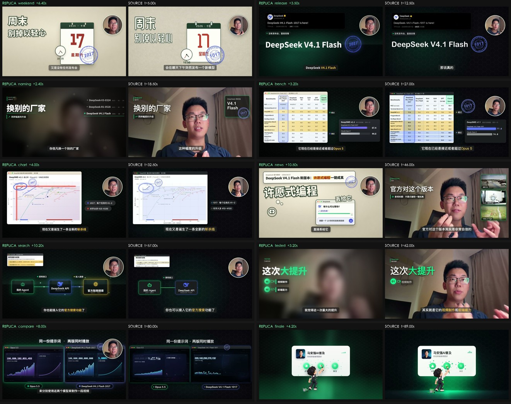

# DeepSeek V4.1 Flash 1017 · 抖音动效复刻

> 把一条 90 秒的抖音动效设计长片，用 **HTML / CSS / GSAP** 逐帧重建为可交互网页：
> 11 个分镜、中文字幕、播放器、原片对照 PIP，并且可以按任意时间点精确 seek、逐帧渲染成 MP4。
>
> A frame-accurate motion-design replica of a 90-second Douyin video, rebuilt entirely in
> HTML / CSS / GSAP — no source-video playback driving the animation.



> 原片：抖音 **@马安强AI普及**《DeepSeek 新模型硬刚 Opus 5.5 / DeepSeek V4.1 Flash 1017》，
> 1280×720 / 90.3s。本仓库为动效与前端技术的学习型复刻，视频与文案版权归原作者所有。

---

## 成品预览

| 产物 | 说明 |
| --- | --- |
| [`web/index.html`](web/index.html) | 可交互复刻网页：11 个分镜 + 字幕 + 播放器 + 原片对照 PIP |
| [`web/preview.mp4`](web/preview.mp4) | 全片渲染成片：1280×720 / 30fps / 90.35s / 2710 帧 |
| [`web/compare.mp4`](web/compare.mp4) | 分章左右对照视频：左复刻 / 右原片，1920×576，含原声音轨 |
| [`web/compare/*.jpg`](web/compare) | 10 个分镜的「复刻 vs 原片」静止对照图 + 总览图 |
| [`BUILD_SPEC.md`](BUILD_SPEC.md) | 协作规范 / 场景任务书（引擎契约、画面规范、逐场景分镜细节） |

## 快速开始

```bash
# 方式一（最简单）：直接双击 web/index.html，浏览器打开后点「播放复刻」
open web/index.html

# 方式二（推荐，本地服务器，默认 8080 端口）
cd web && ./start.sh
# 或手动：python3 -m http.server 8080 -d web

# 无 UI 渲染模式（1:1 舞台，供截图/渲染工具使用），可指定时间点
open "web/index.html?render=1&t=12.5"
```

无需构建、无需 npm 安装：GSAP 与字体全部本地化，离线可用。

## 播放器控制

| 操作 | 功能 |
| --- | --- |
| `Space` / 左下按钮 | 播放 / 暂停 |
| `←` / `→` | 后退 / 前进 5 秒 |
| `Home` / `End` | 回到开头 / 跳到结尾 |
| `F` | 全屏 |
| `P` | 原片对照画中画（PIP，可开原声） |
| 进度条 | 点击 / 拖拽任意 seek；分段条按 11 个分镜切分 |
| `1×` 按钮 | 1× / 1.25× / 1.5× / 2× 变速 |
| 结尾卡 | 重播 / 跳转任意章节 |

## 技术架构

核心是一个「场景注册 + 全局时钟」的最小引擎（[`web/src/engine.js`](web/src/engine.js)）：

```js
Replica.registerScene({
  id: 'bench',          // 固定 id
  start: 31.0,          // 全局时间轴起点（秒）
  end: 37.5,            // 全局时间轴终点（秒）
  build(root) {
    root.innerHTML = `<div class="bg bg-hex"></div> …自己的 DOM…`;
    const tl = gsap.timeline({ paused: true });   // 必须 paused
    tl.fromTo('.s4-title', { opacity: 0, x: -120 }, { opacity: 1, x: 0, duration: .6 }, 0.2);
    function update(local) { /* 纯函数式状态：文字切换 / 画布绘制 */ }
    return { timeline: tl, update };
  },
});
```

- 舞台固定 **1280 × 720**，每个场景一条 **paused GSAP timeline**；引擎按全局时间
  `tl.time(local)` 精确 seek —— 因此可暂停、可拖拽、可逐帧渲染 MP4，渲染结果确定可复现。
- 禁止用 `requestAnimationFrame` / `setTimeout` / CSS `@keyframes` / `transition` 做编排
  （无法逐帧回放）；循环动效使用 GSAP `repeat: -1`。
- 字幕是独立时间轴（[`web/src/captions.js`](web/src/captions.js)），复刻原片同款深灰圆角条 + 金/红关键词高亮。
- 共享组件见 [`web/src/shared.js`](web/src/shared.js)：`UI.stamp` / `UI.avatar` / `UI.win` / `UI.sticker` / `UI.splitChars`。

## 分镜（复刻时间轴 ↔ 原片时间轴）

| # | scene id | 复刻时间 | 原片时间 | 内容 |
| --- | --- | --- | --- | --- |
| 01 | `weekend` | 0.0–8.5s | 0–6s | 纸拼贴「周末·别掉以轻心」：日历翻页 12→14→16→17、16:35 圆钟、1017 印章 |
| 02 | `today` | 8.5–16.0s | 6–9s | 「就在今天」：17 号日历、发布会 VIP 票券、「没有」红贴纸、预热海报 |
| 03 | `release` | 16.0–24.5s | 9–16.5s | 暗场官方推文卡 →「DeepSeek V4.1 Flash」大标题 → 版本命名列表 |
| 04 | `naming` | 24.5–31.0s | 16.5–23.5s | B-roll 叠层「NAMING / 换别的厂家」、跨代大版本、不讲武德 |
| 05 | `bench` | 31.0–37.5s | 23.5–30s | 官方跑分 11 项 macOS 窗口 + DeepSWE 条形对比浮层 |
| 06 | `chart` | 37.5–44.0s | 30–35.5s | 通过率 / 每任务费用散点折线图 + 红色「斩杀线」描绘 |
| 07 | `news` | 44.0–57.5s | 35.5–44.5s | 官方新闻条 + 巨型描边贴纸「许愿式编程」+ DeepSeek 聊天窗打字 |
| 08 | `search` | 57.5–68.0s | 44.5–58.5s | Search & Fetch APIs 推文 + API 文档卡 + 三卡 pipeline |
| 09 | `tested` | 68.0–74.0s | 58.5–66s | 「TESTED / 这次大提升」+ 01 视频制作 / 02 前端能力 |
| 10 | `compare` | 74.0–86.0s | 66–86s | prompt 卡 → 双 macOS 窗口「Opus 5.5」vs「DeepSeek V4.1 Flash 1017」+ canvas 双 mini 动效 |
| 11 | `finale` | 86.0–90.35s | 86–90.3s | 黑绿体积光终章：关注卡 + 点赞 / 收藏 / 关注绿色圆钮 |

## 目录结构

```
.
├── web/                       # 复刻网页（成品）
│   ├── index.html             # 单页入口（11 场景 + 字幕 + 播放器 + PIP）
│   ├── start.sh               # 一键本地预览
│   ├── preview.mp4            # 全片渲染成片
│   ├── compare.mp4            # 分章左右对照视频
│   ├── compare/               # 复刻 vs 原片静止对照图
│   ├── src/
│   │   ├── tokens.css         # 设计变量（配色 / 字体 / 阴影 / 缓动）
│   │   ├── base.css           # 舞台、背景、共享组件、字幕、HUD 样式
│   │   ├── engine.js          # Replica 引擎：场景注册 / 全局时钟 / seek / 字幕 / 渲染模式
│   │   ├── shared.js          # UI.stamp / avatar / win / sticker / splitChars
│   │   ├── captions.js        # 逐场景字幕时间轴
│   │   ├── main.js            # 启动层、播放器 HUD、PIP 原片对照、章节
│   │   └── scenes/            # 11 个场景（js + css 一对一）
│   └── assets/                # 字体 / 图片 / 原片 / GSAP（全部本地化）
├── tools/                     # 渲染与 QA 工具（Playwright + ffmpeg）
│   ├── shot.py                # 按时间点截图（逐帧 QA）
│   ├── render.py              # 逐帧渲染 MP4
│   ├── compare.py             # 生成「复刻 vs 原片」左右对比图
│   ├── compare_chapters.py    # 合成分章对照视频（1920×576 + 原声音轨）
│   └── verify.py              # 集成自检（场景注册 / seek / 空白 / 控制台错误）
├── project/                   # 分析素材、截图、对比图、渲染产物（过程文件）
├── artifacts/                 # 原片转录（ASR）、关键帧、抽帧、第三方工具
├── video/                     # 原片及其音视频轨
└── BUILD_SPEC.md              # 协作规范 + 逐场景任务书
```

## 渲染与 QA

依赖：`python3`、`playwright`（Chromium）、`ffmpeg`。

```bash
# 单帧截图（输出到 project/shots/）
python3 tools/shot.py --scene bench --local 0.5,1.5,3,4.5

# 全片渲染（约 5–8 分钟）
python3 tools/render.py --fps 30 --out web/preview.mp4

# 复刻 vs 原片左右对比图
python3 tools/compare.py --items "weekend@6.4@5,bench@3.2@27"

# 分章对照视频（左侧复刻 / 右侧原片，每章各自从场景起点对齐 + 原声）
python3 tools/compare_chapters.py --replica web/preview.mp4 --out web/compare.mp4

# 集成自检（11 场景是否注册 / 可 seek / 非空白 / 控制台错误）
python3 tools/verify.py
```

逐帧 QA 的方法：用 `shot.py` 截图后，与 `project/keyframes_all/s_0NN.jpg`（原片 1fps 抽帧，
对应 t=NN 秒）逐一对照构图、字号、层级与颜色。

## 过程资产说明

| 目录 | 内容 |
| --- | --- |
| `project/shots/` | 各场景逐时间点复刻截图（QA 用） |
| `project/keyframes/`、`project/keyframes_all/` | 原片高清关键帧 / 1fps 抽帧（t=1…90s） |
| `project/render/` | 渲染中间产物（分章 MP4、拼接清单等） |
| `project/compare/`、`project/crops/`、`project/verify/` | 对比图、素材裁剪、集成自检报告 |
| `artifacts/source/` | 原片元信息、语音识别转录（`transcript.srt` / `.txt` / `asr.raw.json`） |

> 仓库包含完整过程资产（约 350 MB，含截图与视频），克隆时请留意体积。

## 版权与许可

- 原视频、文案、人物形象版权归抖音 **@马安强AI普及** 所有；本复刻仅用于 **动效与前端技术学习**，
  不用于商业用途。头像 / DeepSeek logo / 终章形象取自原片视频帧裁剪，仅作复刻演示。
- 字体：Noto Sans SC、Zilla Slab、Playfair Display、DM Serif Display、Bodoni Moda（均为 SIL OFL）。
- 动效、布局、图表、表格数据均按原片画面重新绘制定位；字体为近似替代，尺寸按 1280×720 实测标定。

## 已知差距

- 原片真人出镜镜头无法复刻：本复刻保留其图文叠层设计，背景用原片静帧或暖色虚化底图替代实拍。
- 原片有视频调色与压缩纹理，网页版为纯色 / 程序纹理，纸面质感与暗场噪点只能近似。
- 部分中文字体为 Noto Sans SC Black 近似替代，与原片字体细节略有差异。

---

更多工程细节见 [`web/README.md`](web/README.md) 与 [`BUILD_SPEC.md`](BUILD_SPEC.md)。
